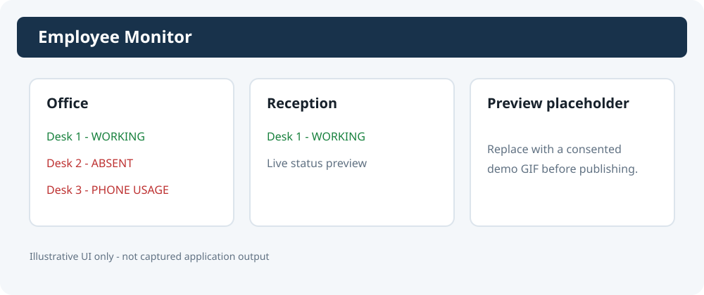
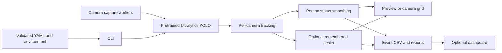

# Employee Monitor

Local-first person and phone detection with optional remembered-desk absence alerts.

[](https://github.com/YOUR_GITHUB_USERNAME/employee-monitor/actions/workflows/ci.yml)
[](https://www.python.org/)
[](LICENSE)


## Demo



*Illustration only; replace with a short, consented demo GIF before publishing.*

## Features

- Detect mode is the default: only detected people and phones receive moving boxes; no desk rectangles or calibration are needed.
- Stable tracked person IDs, smoothed `WORKING` / `PHONE USAGE` labels, and yellow phone boxes.
- Optional remembered desks that can raise timed `ABSENT` and urgent alerts after an area has first been occupied.
- Optional legacy `desks` mode for zone-based status and calibration.
- Webcam, local video, and RTSP/HTTP stream inputs; reconnecting capture workers and multi-camera previews.
- Local event CSV, daily CSV/HTML/PDF reports, and an optional live dashboard.
- Optional low-light CLAHE preprocessing, face blur, GPU inference, and phone pose/tile options.
- No raw video is saved unless `output.save_video` is enabled.

## How it works



See [Architecture](docs/architecture.md) for component details and [Usage](docs/usage.md) for operational guidance.

## Quick start (Windows PowerShell)

Python 3.9 or newer is required. From the repository directory:

```powershell
python -m venv .venv
.\.venv\Scripts\python.exe -m pip install -e ".[dev]"
.\.venv\Scripts\employee-monitor.exe --config configs/config.example.yaml
```

Activate the virtual environment with `.\.venv\Scripts\Activate.ps1` if you want to use the shorter `employee-monitor` command shown below.

The example config uses webcam index `0` and detect mode. On its first run, Ultralytics downloads the configured `yolov8n.pt` model weights if they are not already available. Their local location follows Ultralytics and the working directory; `*.pt` files are ignored by this repository. By default, desk memory is enabled and stored locally under `desks/`; disable it with `--no-desk-memory` or clear it with `--clear-desks`.

The CLI also accepts an explicit `run` subcommand:

```powershell
employee-monitor run --config configs/config.example.yaml
```

Useful options and subcommands:

```powershell
employee-monitor --test-camera 0
employee-monitor --headless --config configs/config.example.yaml
employee-monitor --grid --config configs/config.example.yaml
employee-monitor --dashboard --config configs/config.example.yaml
employee-monitor --clear-desks --config configs/config.example.yaml
employee-monitor --no-desk-memory --config configs/config.example.yaml
employee-monitor select-zones --config configs/config.example.yaml --camera office
```

Press **Esc** to stop a visible preview and **Space** to pause or resume it. `--max-frames N` is available for bounded smoke runs. The GUI selector requires a graphical desktop.

## Cameras and configuration

The tracked example is [configs/config.example.yaml](configs/config.example.yaml). Copy it to the ignored `configs/config.yaml` if you want to make changes, then run `employee-monitor --config configs/config.yaml`. A webcam source needs no credential setup:

```yaml
mode: detect
cameras:
  - name: office
    source: 0
```

For an RTSP camera, put the full URL in a local `.env` file next to the config (the repository includes a blank [.env.example](.env.example)) and reference the variable:

```yaml
cameras:
  - name: office
    source: ${CAMERA_RTSP_URL}
```

Set `CAMERA_RTSP_URL` in the local `.env` file or process environment. Never commit credentials or paste credential-bearing stream URLs into issues, logs, screenshots, or public config files. To find the correct stream path, consult the camera vendor documentation and enable RTSP/ONVIF as appropriate. Network cameras should not be exposed directly to the public internet.

### Main configuration settings

| Setting | Purpose |
| --- | --- |
| `mode` | `detect` (default, no fixed zones) or optional zone-based `desks`. |
| `model.name`, `model.fallback` | Ultralytics weight names; defaults to `yolov8n.pt` and `yolov8s.pt`. |
| `model.imgsz` | Inference image size; default `960`. |
| `model.person_conf`, `model.phone_conf`, `model.object_conf` | Detection confidence thresholds; phone defaults to `0.15` (COCO class 67). |
| `model.use_gpu` | Try CUDA when available; otherwise inference uses CPU. |
| `status.stable_frames` | Observations required before changing a person's displayed status. |
| `status.persistence_frames` | Missed frames tolerated before a person track is removed. |
| `status.phone_proximity_ratio` | Distance allowance used when associating phones with people. |
| `desks_memory.enabled` | Enable local remembered-desk learning and absence alerts (default `true`). |
| `desks_memory.min_still_seconds` | Nearly-stationary time required before remembering an area (default `5`). |
| `desks_memory.absent_after_seconds`, `urgent_after_seconds` | Empty-time thresholds for `ABSENT` (default `3`) and urgent escalation (default `30`). |
| `desks_memory.margin`, `max_desks`, `forget_after_minutes` | Desk-box expansion, per-camera limit, and forgetting policy (`0` means never forget). |
| `desks_memory.webhook_url` | Optional HTTP(S) urgent-alert endpoint. Keep secret URLs out of committed config. |
| `preprocessing.clahe` | Optional CLAHE low-light preprocessing; off by default. |
| `privacy.blur_faces` | Optional local face blurring; this is not guaranteed anonymization. |
| `output.save_video` | Write annotated output video; off by default. |
| `dashboard.host`, `dashboard.port` | Dashboard bind address and port; defaults to `127.0.0.1:8000`. |

The full parser validates camera sources and settings when loading the YAML file. For `mode: desks`, optional discovery and `employee-monitor select-zones` are available; no calibration is needed in the default detect mode.

## Dashboard and reports

Start the live dashboard with `employee-monitor --dashboard --config configs/config.example.yaml`. Open `http://127.0.0.1:8000` on the same machine. The dashboard shows per-camera statuses, recent status events, and CSV/HTML/PDF export links. In detect mode, tracked-person status changes and remembered-desk absence start/end/urgent events are logged to `logs/events.csv`; absence duration is recorded when the person returns. Remembered-desk status is also shown in the dashboard.

The application stores status events and desk-memory JSON, not raw camera footage by default. Annotated video output is only written when explicitly enabled. Protect logs, desk-memory files, any exports, and the dashboard as potentially sensitive workplace information.

## Docker

Build the image with `docker build -t employee-monitor .`. The default image command runs headless with the dashboard enabled. Containerized webcam access is platform-specific; RTSP deployments need network access and should use an external config with `dashboard.host: 0.0.0.0` if the dashboard must be reachable outside the container. Publish only trusted dashboard access, and mount local logs/desk-memory paths for persistence. See [Usage](docs/usage.md) before exposing any network service.

## Performance and limitations

- Pretrained YOLOv8 detection is approximate. Occlusion, camera angle, lighting, image resolution, and device performance affect detections; no accuracy claim is made here.
- Phone usage is an estimate based on visual proximity and optional pose cues, not proof of behavior. Validate it using representative footage and human review.
- Desk memory uses stationary-person observations and nearby detected objects as a heuristic; it is not proof of a person's identity or assigned workstation.
- The default CPU path may be slow at `imgsz: 960`. GPU availability depends on the installed PyTorch build and compatible drivers.
- The dashboard has no authentication. Keep its default loopback binding unless deployed behind an appropriately secured access layer.
- Webcam and GUI behavior depend on the host environment. See the verification checklist at the end of this README for what has and has not been tested.
- This project is not an attendance, productivity, safety, disciplinary, or employment-decision system.

## Privacy and ethics

Inform employees before monitoring and comply with applicable law. In Morocco, workplace video and personal-data processing may be subject to **Law 09-08** and **CNDP** requirements; in the EU/EEA, **GDPR** may apply. Determine a lawful and proportionate purpose, provide required notice, restrict access, set retention limits, and seek qualified legal/CNDP guidance. This section is informational, not legal advice.

Video storage is disabled by default, but event logs and remembered-desk files can still reveal workplace routines. Enable face blur only as a limited privacy aid: the face detector may miss faces, so blur is not a privacy guarantee. Do not use the output as the sole basis for consequential decisions about people.

## Model and dependency licensing

This repository's own source is offered under the MIT License. Detection uses the Ultralytics Python package and pretrained YOLOv8 weights, which are subject to Ultralytics' **AGPL-3.0** terms unless an alternative commercial license applies. Ultralytics describes AGPL use as appropriate when you are comfortable open-sourcing the full project, and offers an Enterprise license for some private, proprietary, commercial, or network-service deployments. The MIT license for this repository does not replace or override those terms. Review the [Ultralytics licensing information](https://www.ultralytics.com/license) and [THIRD_PARTY.md](THIRD_PARTY.md) before redistributing, embedding, or operating this software, model weights, or a service based on them. This is not legal advice.

## Development and tests

```powershell
python -m pip install -e ".[dev]"
ruff check .
black --check .
pytest
pre-commit install
```

GitHub Actions runs Ruff, Black, and pytest on pushes and pull requests. The [test suite](tests/) covers configuration, status transitions, desk-memory behavior, event-log format recovery, reporting, and rendering. A passing test suite does not establish model accuracy, webcam compatibility, or GUI behavior.

## Roadmap

- Add a consented, reproducible example video and dashboard GIF.
- Improve desk-memory diagnostics and camera-specific tuning workflows.
- Evaluate authentication and retention controls before any network deployment.
- Test broader hardware and representative, consented camera setups without publishing private footage.

## Contributing

Issues and pull requests are welcome. Keep example configs free of credentials and personal information; do not commit camera footage, model weights, logs, desk-memory JSON, or generated reports. Include a focused test for behavior changes and run Ruff, Black, and pytest before submitting.

## License

Project source: [MIT License](LICENSE), subject to the separate third-party and model licensing terms described above.

## Verification checklist

- [x] Existing project test suite passes: 45 tests.
- [x] Ruff, Black, and both CLI help paths pass in the existing development environment.
- [x] Fresh virtual-environment editable install, 45 tests, Ruff, Black, and CLI help checks.
- [x] Headless inference pipeline smoke check on a short synthetic video made from a bundled sample image; this does not establish real-world detection quality.
- [ ] Webcam capture and interactive GUI selector on supported hardware.
- [ ] First-run model download, Docker build, and external alert hooks.
- [ ] Production accuracy, privacy, security, and legal suitability (not established by this project).
