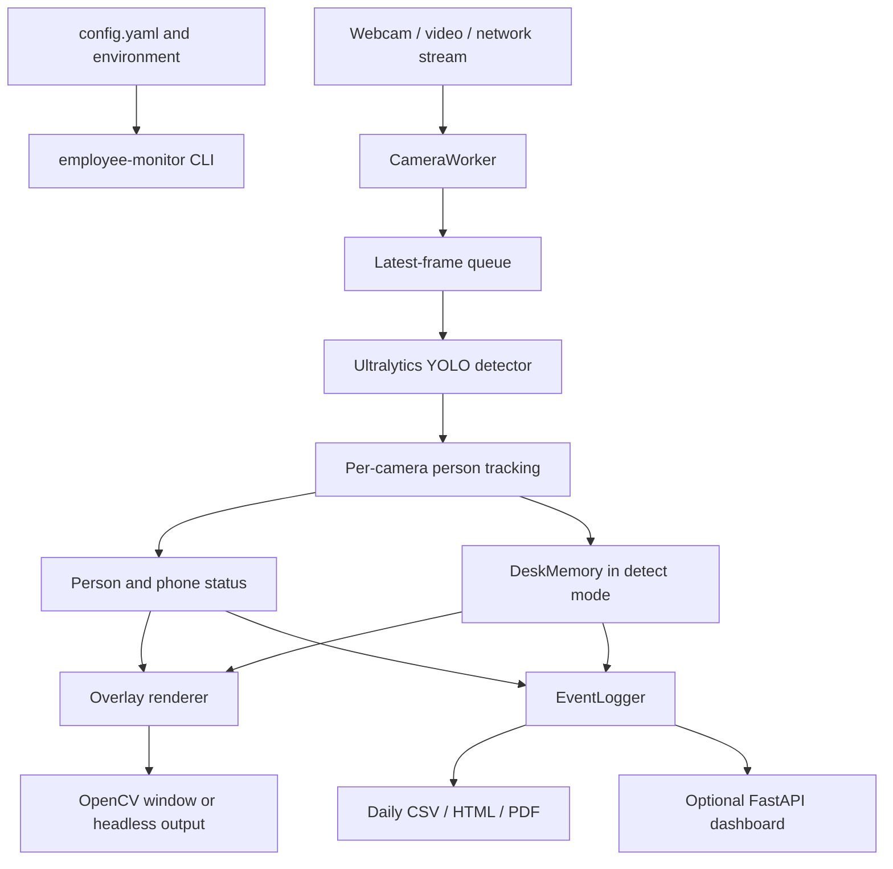

# Architecture

Employee Monitor is a local Python application organized as a `src/` package. The CLI loads and validates YAML configuration, starts one bounded capture worker per camera, and sends the latest frames to the detector.

## Runtime flow

1. `employee_monitor.config` reads YAML, optionally loads a sibling `.env`, expands camera-source environment variables, and validates settings.
2. `employee_monitor.capture` runs camera reads independently and retains the latest frame to avoid an unbounded latency queue.
3. `employee_monitor.detection` calls the pretrained Ultralytics detector and converts model results into internal detection records.
4. In default `detect` mode, person tracks feed the status smoother; phones are assigned by proximity. Desk memory is optional and stores per-camera JSON state.
5. In optional `desks` mode, existing zones are loaded or discovered, then per-zone statuses are updated.
6. Rendered frames go to a local window or headless processing. Status and desk events are logged; dashboard and report exports are optional.

The application does not persist raw video unless `output.save_video` is enabled. Event logs and desk memory can nevertheless contain sensitive workplace information and should be access-controlled and retained only as needed.

## Package map

| Module | Responsibility |
| --- | --- |
| `config.py` | Configuration models, validation, environment expansion, source paths. |
| `capture.py` | Camera/video capture workers and source test. |
| `detection.py`, `tracking.py` | Model inference and tracked detections. |
| `status.py`, `desk_memory.py`, `zones.py` | Person statuses, optional remembered desks, and legacy zone mode. |
| `rendering.py`, `privacy.py` | Overlays, grid rendering, optional face blur. |
| `reporting.py`, `api.py` | Event CSV, daily exports, and dashboard. |
| `cli.py`, `zone_selector.py` | Main entry point and optional interactive zone selector. |
